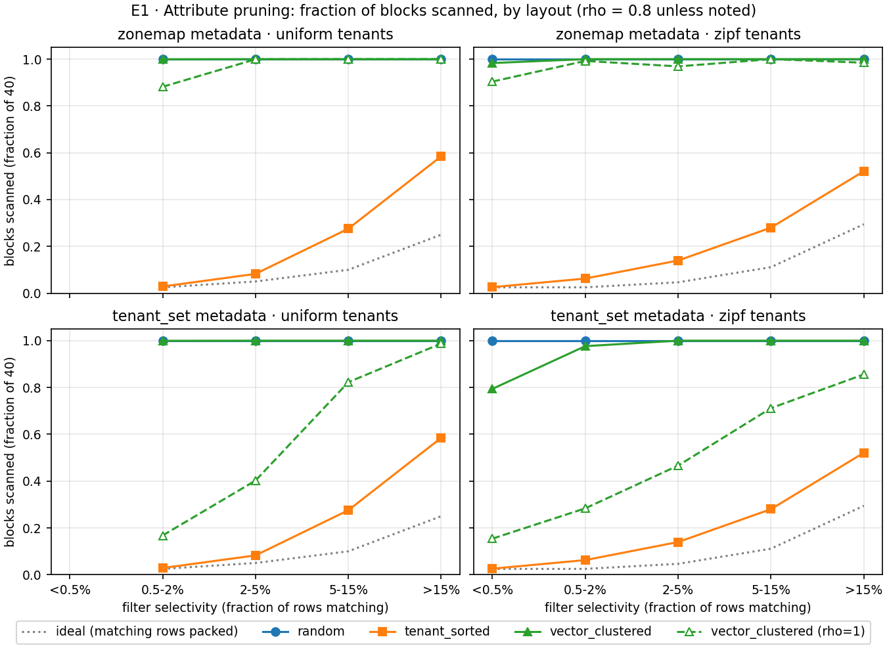
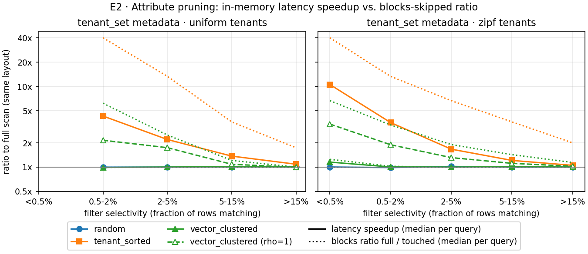
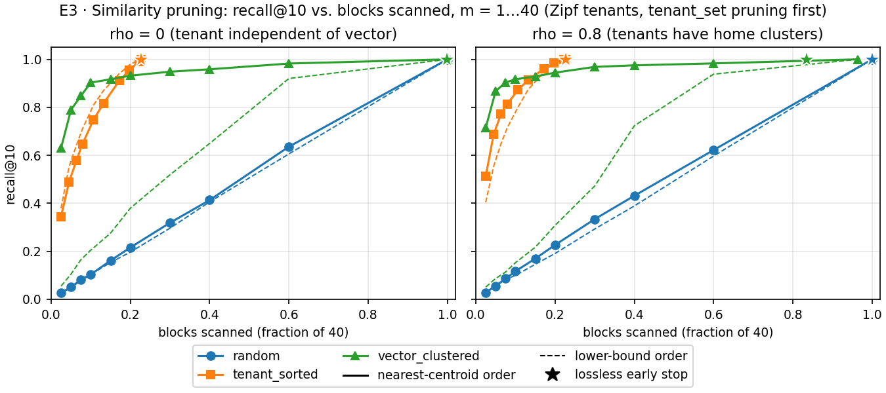
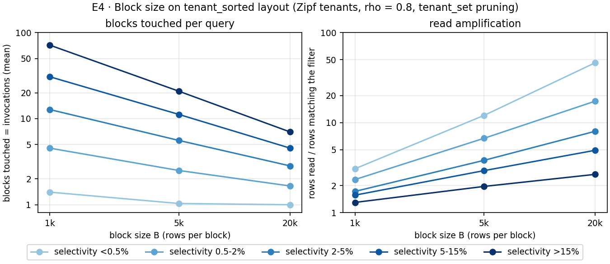

# filtered-block-pruning

A small prototype that measures **block pruning for tenant-filtered vector search**. Given a
query vector and a filter `tenant_id IN (...)`, it returns the 10 nearest rows (L2) among the rows
that match, while touching as few fixed-size blocks as possible.

Each block touched stands for one fetch and one function invocation in a serverless vector
database, so **blocks touched** is the main cost metric. Recall@10 is measured against an exact
full scan. Everything is synthetic, in memory and single-threaded.

The full working log is in [NOTES.md](NOTES.md). It has the hypotheses with predictions written
before each run, the design decisions, and every result and surprise.

## Summary

Setup: 200,000 rows of 64 dimensions, 100 tenants, blocks of 5,000 rows (40 blocks), and 200
queries per configuration.
- **Layouts:** rows are stored in one of three orders: `random`, `tenant_sorted`, or
  `vector_clustered` (by k-means).
- **`rho`** sets how strongly each tenant's rows are tied to its 3 home clusters, from 0 (not at
  all) to 1 (always).

Details are under [What is compared](#what-is-compared).

1. **Attribute pruning works only when the layout keeps each tenant's rows together.** On
   `tenant_sorted` an exact tenant filter skips up to 97% of blocks; on `random` it skips none.
2. **The best layout for the filter is the worst for similarity, and the other way round.**
3. **Ranking blocks by centroid gives a cheap approximate answer** on `vector_clustered`: 90% of
   the true top-10 after 3–4 of 40 blocks. The last 10% costs most of the blocks.
4. **The provable lower bound is too loose to help much** on this data.
5. **In memory, latency falls far less than blocks touched.** Blocks touched, which means
   invocations, is the cost to report.
6. **Block size trades invocations against wasted reads**, and the best size depends on the mix
   of queries.

## Main results

### E1: How many blocks does attribute pruning skip?



The table shows the fraction of the 40 blocks scanned with uniform tenants. Each tenant holds 1%
of the rows, so filters on 1 / 3 / 10 / 25 tenants match 1 / 3 / 10 / 25% of rows.

| Layout and metadata | 1 tenant | 3 | 10 | 25 |
|---|---|---|---|---|
| `random`, `zonemap` or `tenant_set` | 100% | 100% | 100% | 100% |
| `tenant_sorted`, `zonemap` or `tenant_set` (identical) | 2.9% | 8.2% | 27.6% | 58.5% |
| `vector_clustered`, `tenant_set`, `rho` = 0.8 | 100% | 100% | 100% | 100% |
| `vector_clustered`, `tenant_set`, `rho` = 1.0 | 17% | 40% | 82% | 99% |
| `vector_clustered`, `zonemap`, `rho` = 1.0 | 88% | 100% | 100% | 100% |

With Zipf tenants, `tenant_sorted` scans from 3% to 52% of blocks, going from the most to the
least selective bucket. Recall@10 is 1.00 in every cell, because both kinds of metadata are
lossless.

**Interpretation**
- **The layout decides the saving, not the metadata.** Metadata can only skip a block that holds
  no matching row. In `random` order every block holds all 100 tenants, so even an exact bitmap
  skips nothing.
- **On `tenant_sorted` the cost is 2.3–2.9 times the selectivity,** not "selectivity plus a
  little". A block holds about 3 tenants, and the tenants in a random IN-list rarely share a
  block, so each requested tenant costs about one block of its own.
- **The 8-byte zone map equals the exact bitmap on `tenant_sorted`,** because tenants are
  contiguous: every tenant inside a block's [min, max] range really is in the block. On the
  other layouts a block's range covers 88–100 of the 100 tenant ids, so the zone map is useless.
- **`vector_clustered` scatters each tenant across blocks,** because it keeps similar vectors
  together. It prunes only when tenants are tied to few clusters (`rho` = 1.0). Even then it
  scans 17% of blocks for one tenant, against 2.9% on `tenant_sorted`.

### E2: Does latency fall as much as blocks touched?



Medians per query, comparing `tenant_set` with the full scan of the same query, on
`tenant_sorted`:

| Filter | Blocks ratio | Latency speedup | Full scan / pruned |
|---|---|---|---|
| Zipf, <0.5% of rows | 40× | 10.6× | 2.67 / 0.25 ms |
| Uniform, 1 tenant (1%) | 40× | 4.3× | 3.18 / 0.75 ms |
| Uniform, 3 tenants (3%) | 13.3× | 2.2× | 5.27 / 2.35 ms |
| Uniform, 10 tenants (10%) | 3.6× | 1.4× | 10.91 / 7.98 ms |
| Uniform, 25 tenants (25%) | 1.7× | 1.1× | 22.52 / 21.24 ms |

`vector_clustered` at `rho` = 1.0 gets a 2.2–3.4× speedup for 6–7× fewer blocks. On `random`,
where nothing is pruned, the tenant check costs nothing measurable (1.0×).

**Interpretation**
- **Skipping a block with no matching row saves only about 0.06 ms in memory,** the cost of
  checking 5,000 tenant ids. Most of the time goes into distances for matching rows, and every
  lossless method computes exactly those.
- **The two cells with 40× fewer blocks confirm this.** The Zipf queries in the <0.5% bucket have
  a median of 426 matching rows, against 2,000. Their pruned scan is 3 times cheaper (0.25 ms
  against 0.75 ms), while both full scans cost about the same.
- **In-memory latency understates the saving.** In a serverless system each skipped block is also
  a skipped fetch and function invocation, which in-memory timing does not include. Blocks
  touched is the better cost measure.

### E3: Recall against blocks scanned with similarity ranking



These runs use Zipf tenants. Blocks are first filtered with `tenant_set`, then scanned nearest
centroid first (or smallest lower bound first), up to a budget of m blocks. The table gives the
blocks actually scanned, out of 40.

| Layout, block order | `rho` | Recall after 1 block | Blocks scanned for recall ≥ 0.9 | Blocks scanned for recall 1.0 |
|---|---|---|---|---|
| `random`, centroid | 0 and 0.8 | 0.03 | 40 (100%) | 40 (100%) |
| `tenant_sorted`, centroid | 0 | 0.34 | 6.9 (17%) | 9.1 (23%) |
| `tenant_sorted`, centroid | 0.8 | 0.51 | 5.3 (13%) | 9.1 (23%) |
| `vector_clustered`, centroid | 0 | 0.63 | 4 (10%) | 40 (100%) |
| `vector_clustered`, centroid | 0.8 | 0.71 | 3 (7.5%) | 38.5 (96%) |
| `vector_clustered`, lower bound | 0.8 | 0.05 | 24 (60%) | 38.5 (96%) |

- **On `vector_clustered`, recall climbs fast and then flattens:** it stays at 0.93–0.98 between 8
  and 24 blocks.
- **The lossless early stop** skips a block whose lower bound exceeds the current 10th-best
  distance. Recall stays at 1.00.
  - On `vector_clustered` at `rho` = 0.8 it scans 83.5% of blocks instead of 96.4%, and computes
    13.5% fewer distances.
  - It saves nothing on the other layouts, or at `rho` = 0.

**Interpretation**
- **Ranking by centroid only helps when a block's centroid says something about its rows.**
  - On `vector_clustered` it does, so 3–4 blocks hold 90% of the answer.
  - On `random` every centroid is about the same average, so recall just grows with the share of
    blocks scanned.
  - On `tenant_sorted` the filter has already done most of the work: about 9 blocks survive, and
    scanning them all is exact.
- **The lower bound `‖q − c‖ − r` is too loose to order blocks.** The 64 true clusters are cut
  into 40 fixed-size blocks, so a block mixes about 2 clusters. Its radius is then nearly as large
  as a random block's (about 10.7 against 11.6). In a smaller test, 81–100% of blocks had a bound
  of 0, so ordering by bound mostly falls back to block-id order.
- **The early stop can only skip a block whose bound exceeds the 10th-best distance found so
  far.** That happens on `vector_clustered` at `rho` = 0.8. This is likely because many matching
  rows sit in the query's own cluster there, which makes the 10th-best distance small (not
  checked).
- **The long tail is likely caused by clusters that are split across blocks** (not checked). The
  blocks holding the last few top-10 rows also hold other clusters, so their centroids sit far
  from the query.

### E4: Effect of block size



These runs use `tenant_sorted` with Zipf tenants and `tenant_set` pruning. The table gives means
per selectivity bucket.

| Filter matches | Blocks touched, B = 1k / 5k / 20k | Rows read per matching row, 1k / 5k / 20k |
|---|---|---|
| <0.5% of rows | 1.4 / 1.0 / 1.0 | 3.1 / 12.0 / 46.3 (worst query: 68) |
| 0.5–2% | 4.5 / 2.5 / 1.7 | 2.3 / 6.7 / 17.3 |
| 2–5% | 12.8 / 5.6 / 2.8 | 1.7 / 3.8 / 8.0 |
| 5–15% | 30.7 / 11.2 / 4.6 | 1.6 / 2.9 / 4.9 |
| >15% | 71.5 / 20.8 / 7.0 | 1.3 / 2.0 / 2.7 |

Total metadata is 108.2 KB at B = 1k, 21.6 KB at 5k and 5.4 KB at 20k. The centroid and radius
are 96% of it.

**Interpretation**
- **Larger blocks waste more rows.** Each requested tenant wastes about one block's worth of rows
  at its edges.
- **Selective queries suffer most.** From 1k to 20k they save almost no invocations (1.4 → 1.0)
  but read 15 times more rows.
- **Broad queries gain the most from large blocks:** 10 times fewer invocations (71.5 → 7.0) for
  only twice the reads.
- **No single block size is best.** The right B depends on the mix of queries. A cost model
  (invocations × fetch time + bytes read) would choose it.

## Conclusions

**Hypotheses.** Each prediction was written before its experiment ran; details are in
[NOTES.md](NOTES.md).

| Hypothesis | Verdict |
|---|---|
| H1: the layout matters more than the metadata | **Supported.** Exact metadata prunes nothing on `random` and up to 97% of blocks on `tenant_sorted`. |
| H2: filter locality and similarity locality conflict | **Supported.** `tenant_sorted` is best for the filter and `vector_clustered` for similarity; neither is good at both. |
| H3: combining both kinds of pruning gives a tunable trade-off, whose shape depends on the layout and on `rho` | **Supported for the layout; only partly tested for `rho`.** Only `rho` = 0 and 0.8 were run, and they differ little. |

**What this means for a serverless, block-based vector store:**
1. **Lay data out by the filter attribute first.** On a tenant-sorted layout, an 8-byte zone map
   per block gives exact filtered results while touching 3–58% of blocks. An exact tenant bitmap
   adds nothing there.
2. **Use similarity ranking as a budget, not as a guarantee.** On a vector-clustered layout, 3–4
   blocks give recall 0.9. Exact answers need almost every block, and the single-centroid lower
   bound saves at most 13% of them.
3. **Neither layout gives both kinds of locality.** A tenant-then-cluster layout, sorted by tenant
   and clustered inside large tenants, is the natural next step to get both. It was not tested
   here.
4. **Measure cost in blocks touched,** not in-memory latency, which hides most of the saving.
5. **Choose the block size per workload:** small blocks for selective filters, large blocks for
   broad ones.

**How the predictions did:**
- **E1 and E4** held to within a few points.
- **E2** got the direction right (latency falls far less than blocks touched), but not where the
  gap is largest relative to the blocks ratio.
- **E3** got the recall curves about right, but wrongly predicted that the early stop would save
  nothing. That prediction rested on a small test setup that did not carry over to full size.

All numbers per selectivity bucket are in [results/summary_table.md](results/summary_table.md).
These results come from synthetic, well-separated data held in memory; see
[Limitations](#limitations).

## What is compared

**Data** (`src/data.py`):
- a Gaussian mixture of 64 clusters;
- each tenant has 3 home clusters, and `rho` is the probability that a row comes from one of them;
- tenants are either uniform (2,000 rows each) or Zipf(1.1) (294 to 46,751 rows);
- filters are IN-lists of 1, 3, 10 or 25 tenants;
- each query is the centre of the cluster of a random matching row, plus noise.

**Layouts** (`src/layout.py`). Each layout is an order of the rows, cut into blocks of B rows.

| Name | Order |
|---|---|
| `random` | random (a seeded shuffle of the arrival order) |
| `tenant_sorted` | stable sort by tenant id |
| `vector_clustered` | MiniBatchKMeans with N/B clusters, rows sorted by cluster |

**Metadata per block** (`src/metadata.py`):
- zone map: min and max tenant id, 8 B;
- tenant set: an exact bitmap, 13 B for 100 tenants;
- centroid and radius: 520 B, float64. It gives the lower bound `max(0, ‖q − c‖ − r)` on the
  distance from the query to any row in the block.

**Pruners** (`src/search.py`, `PRUNERS`). `search(blocks, query, meta, pruner, k, max_blocks,
early_stop)` scans the blocks a pruner returns, in its order. `max_blocks` limits the scan to the
first m blocks, and `early_stop` skips a block whose lower bound exceeds the current 10th-best
distance.

| Name | Blocks scanned, in order |
|---|---|
| `none` | all blocks: the full-scan baseline and ground truth |
| `zonemap` | blocks whose tenant range covers a requested tenant |
| `tenant_set` | blocks whose bitmap holds a requested tenant |
| `tenant_set_by_centroid` | as `tenant_set`, nearest centroid first |
| `tenant_set_by_bound` | as `tenant_set`, smallest lower bound first |

**Experiments** (`experiments.py`):

| ID | Question | Varies |
|---|---|---|
| E1 | How many blocks does attribute pruning skip? | layout × {`zonemap`, `tenant_set`} × {uniform, Zipf} × `rho` ∈ {0.8, 1.0} |
| E2 | Does latency fall as much as blocks touched? | as E1, timed against the full scan of the same query |
| E3 | Recall against blocks scanned with similarity ranking | layout × m ∈ {1, 2, 3, 4, 6, 8, 12, 16, 24, 40} × `rho` ∈ {0, 0.8} × order; plus the early stop (Zipf tenants) |
| E4 | Effect of block size | B ∈ {1k, 5k, 20k} on `tenant_sorted`, Zipf tenants |

## Running it

Needs [uv](https://docs.astral.sh/uv/). It installs Python 3.13 (`.python-version`) and the
locked dependencies (`uv.lock`).

```
uv sync                          # install the locked environment
uv run pytest                    # 252 tests, about 2 minutes
uv run python experiments.py     # all experiments, about 7.5 minutes (or only: e1_e2 e3 e4)
uv run python plots.py           # figures in plots/, results/summary_table.md
```

Without uv, the same commands work with Python 3.13 and `pip install -r requirements.txt`, run
from the repository root.

`experiments.py` writes per-query and summary tables to `results/`, plus `run_config.json`
(parameters, commit, versions, platform). `plots.py` reads them and writes `plots/*.png` and
`results/summary_table.md`.

## Reproducibility

- **Fixed seeds:** data 0, queries 1, layouts 0. Each part has its own generator.
- **One thread** for numpy and scikit-learn.
- **Locked dependencies** in `uv.lock`, with exact pins in `pyproject.toml`.
- **Deterministic ties:** ties in the top-k are broken by row id.
- **Checked:** two full runs on commit `7dcef8e`, and a third from a fresh clone installed with
  `uv sync --frozen`, gave identical results files once timing columns are removed. The hashes
  are in [NOTES.md](NOTES.md), section 10.
- **Timing noise:** median latencies moved by 1.9% between the two runs, 9% at most, so speedup
  differences under about 6% are noise.
- **The committed `results/` and `plots/`** come from the run on commit `7dcef8e`.

## Repository layout

```
src/
  data.py             synthetic dataset and queries
  layout.py           the three layouts, cut into blocks
  metadata.py         zone map, tenant set, centroid and radius, lower bound
  search.py           pruners and the filtered top-k search
  metrics.py          recall, timing, per-query table, per-bucket summary
  reproducibility.py  thread limit, run config, results hash
experiments.py        runs E1-E4 and writes results/
plots.py              draws plots/ and results/summary_table.md
tests/                correctness and consistency tests for all of the above
results/              results of the committed run
plots/                figures of the committed run
NOTES.md              hypotheses, decisions, logs, results, surprises
```

## Limitations

- **The data is easy.** Clusters never overlap, and every query lands in a cluster its tenants
  occupy. Centroid ranking looks better here than it would on real embeddings.
- **In memory, in one process.** No object storage, network or cold starts are modelled; latency
  is only a proxy for cost.
- **No index inside a block.** Search inside a block is exact brute force, with no ANN index, and
  there is no post-filtering baseline.
- **Blocks are fixed-size.** With 64 true clusters in 40 blocks, `vector_clustered` blocks mix
  about 2 clusters each, which keeps them wide and the lower bound loose.
- **The grid was reduced to save time.** E3 ran only `rho` = 0 and 0.8, so how the trade-off
  depends on `rho` is only partly tested. E4 ran three block sizes.
- **One machine** (Windows 11) and one run configuration.

## Next steps

This list was rethought after the results. It is ordered by what the experiments left open. The
first group needs no new code, and later groups build on the earlier ones.

### 1. Close the open questions of this run

- **Run the rest of the grid.** Run E3 at `rho` = 0.5 and 1.0 with every m from 1 to 40, and E4 at
  B = 2k and 10k. H3's claim that the trade-off depends on `rho` is only half tested; this
  finishes it, with one more run of `experiments.py`.
- **Test the two unchecked explanations.**
  - **Early stop:** record the 10th-best distance and each block's lower bound at `rho` = 0 and
    0.8. If the explanation is right, the 10th-best distance is clearly smaller at 0.8.
  - **Long tail:** for queries still missing rows after 8 blocks, find where the blocks holding
    those rows rank in centroid order, and how many true clusters those blocks mix.
- **Try harder data.** Rerun with `noise_std` = 1.0 so that clusters overlap. This shows whether
  centroid ranking still finds 90% of the top-10 in 3–4 blocks, since the current data is the
  easy case.

### 2. Resolve the layout conflict (H2)

The main finding is that no layout gives both filter locality and similarity locality. Three ways
to try to get both:

- **A tenant-then-cluster layout:** sort by tenant, then by k-means cluster inside each tenant.
  - **Expected:** the same tenant pruning as `tenant_sorted` (E1), plus useful centroid ranking
    inside large tenants, which span up to 10 blocks with Zipf tenants.
  - **Effort:** a short change to `src/layout.py`.
  - **How to compare:** against `tenant_sorted` in E3, on queries that include a large tenant.
- **Tighter similarity metadata.** The single centroid and radius gives a lower bound of 0 for
  most blocks, because each block mixes about 2 clusters.
  - **Options:** several sub-centroids per block (k-means inside the block), or one centroid and
    radius per (block, tenant).
  - **Success means:** the bound is above 0 for most blocks, so the early stop and the bound order
    start to prune.
  - **Cost:** more metadata, and the centroid is already 96% of it (E4).
- **Cluster-aligned blocks:** let block boundaries follow k-means clusters (variable-size
  partitions) instead of cutting every 5,000 rows. This gives tighter blocks, at the cost of
  uneven block sizes.

### 3. Measure the cost that matters (E2, E4)

In-memory latency hides most of the saving (E2), and no single block size is best (E4).

- **Build a cost model.** Price each query as invocations × (fetch latency + bytes ÷ bandwidth +
  compute), using measured or published numbers for serverless functions and object storage, and
  recompute E1 and E4 in that unit.
- **Choose B per workload.** With the cost model, pick the block size that is cheapest for a given
  mix of selectivities. Also test whether small and large tenants should get different block
  sizes.
- **Check the model on real storage.** Run the same queries against blocks stored in an object
  store, for example MinIO on a laptop.

### 4. Broaden the setting

- **Streaming ingestion (E5):** how fast tenant pruning decays as unsorted batches arrive, and how
  often compaction must re-sort them.
- **Metadata for many tenants:** E1 shows that the exact tenant set beats the zone map only when
  tenants are clustered but not contiguous (`vector_clustered` at `rho` = 1.0: 17% of blocks
  against 88%). That is the case where a Bloom filter matters, because the exact bitmap grows to
  125 KB per block at 1 million tenants. On a tenant-sorted layout the 8-byte zone map is enough.
- **An ANN index per block** (HNSW or IVF), and how the filter interacts with it.
- **Baselines and realism:** a post-filtering baseline, skewed query popularity (hot blocks), range
  and multi-attribute filters, and real embeddings with real metadata.
